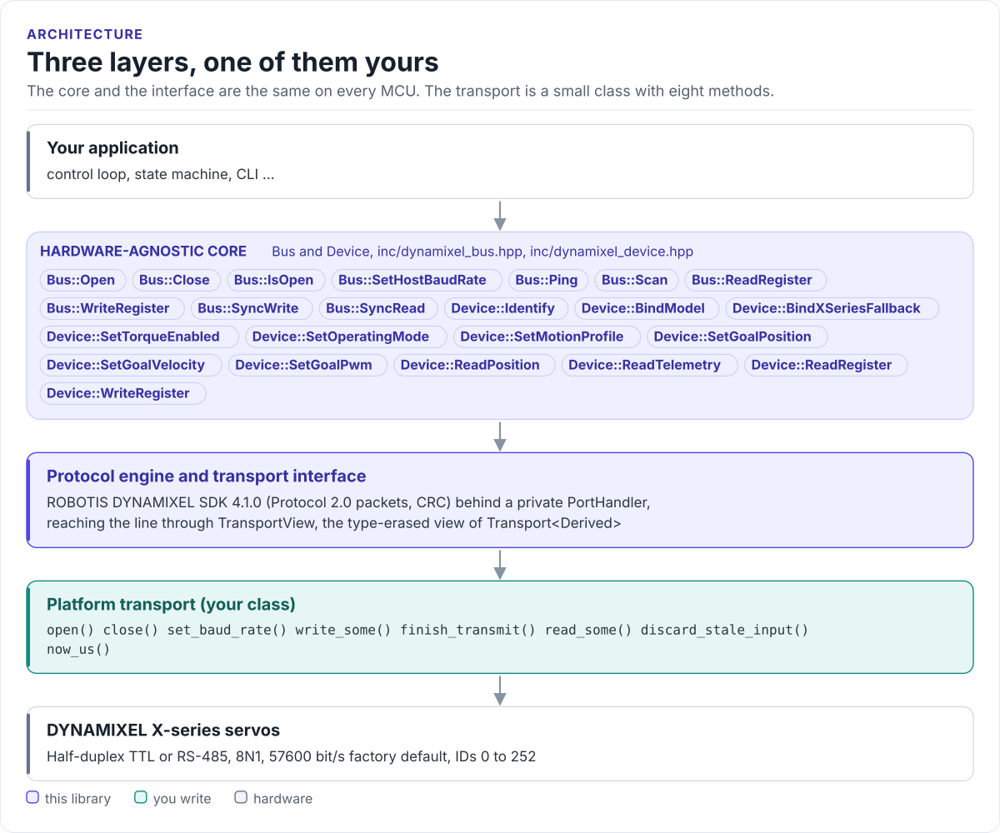

# DYNAMIXEL Driver

A C++17 driver for ROBOTIS DYNAMIXEL X-series smart servos: identify, configure, move and read them over
Protocol 2.0 on a half-duplex UART, from any MCU, with the official ROBOTIS SDK as the packet engine.

[](https://github.com/hardfoc/hf-dynamixel-driver/actions/workflows/host-tests.yml)
[](https://github.com/hardfoc/hf-dynamixel-driver/actions/workflows/esp32-examples-build-ci.yml)
[](https://hardfoc.github.io/hf-dynamixel-driver/)
[](LICENSE)

**Documentation: <https://hardfoc.github.io/hf-dynamixel-driver/>**

<!-- figure: driver-layers -->
<picture>
  <source media="(prefers-color-scheme: dark)" srcset="docs/diagrams/driver-layers.dark.svg">
  
</picture>
<!-- /figure -->

## In 30 seconds

Write a small transport class for your MCU (UART bytes in and out, end of transmission, a microsecond clock;
[Porting](https://hardfoc.github.io/hf-dynamixel-driver/latest/porting/)), then:

<!-- generated: quickstart-code -->
```cpp
#include "dynamixel.hpp"

int read_servo_1(MyUart& uart) {
  dynamixel::Bus bus{dynamixel::TransportView{uart}};      // braces: see "most vexing parse"

  dynamixel::TransportConfig cfg{};                         // 1. 57600 bit/s, 8N1: factory default
  if (!bus.Open(cfg)) {
    return -1;                                              // your transport's open() failed
  }

  dynamixel::Device servo(bus, 1);                          // 2. factory ID is 1
  const auto ping = servo.Identify();                       //    ping + catalog lookup
  if (ping.error == dynamixel::DriverError::UnsupportedRequest) {
    servo.BindXSeriesFallback();                            //    answered, model not in the catalog
  } else if (!ping) {
    return -2;                                              // Timeout: wiring, power, baud, ID
  }

  const auto tel = servo.ReadTelemetry();                   // 3. torque stays off
  if (!tel) {
    return -3;
  }
  std::printf("position %ld ticks, %u.%u V\n", static_cast<long>(tel.value.position),
              tel.value.voltage_0p1_v / 10U, tel.value.voltage_0p1_v % 10U);
  return 0;
}
```
<!-- /generated -->

## What it does

- `Bus` owns one serial line: ping, scan, register reads and writes, sync read and sync write.
- `Device` is one servo: `Identify()`, torque, operating mode, motion profile, position, velocity and PWM goals,
  telemetry.
- Knows seven X-series models by model number (XC430, XL430, XM430, XH430) and runs others on a shared X-series
  fallback.
- Wraps ROBOTIS DYNAMIXEL SDK 4.1.0 for packets and CRC; the public headers never include it.
- Every call returns a `DriverResult` with a `DriverError` and the raw SDK and servo codes; a lost write reply is
  `UncertainOutcome`.
- No constructor opens the UART, enables torque or moves a servo; no exceptions, no RTOS.

## Install

```bash
git submodule add https://github.com/hardfoc/hf-dynamixel-driver.git external/hf-dynamixel-driver
git submodule update --init --recursive external/hf-dynamixel-driver
```

```cmake
add_subdirectory(external/hf-dynamixel-driver)
target_link_libraries(my_app PRIVATE hf::dynamixel)
```

ESP-IDF: use the component wrapper in [`components/hf_dynamixel`](components/hf_dynamixel/CMakeLists.txt).
Details: [Installation](https://hardfoc.github.io/hf-dynamixel-driver/latest/installation/).

## Documentation

| | |
| --- | --- |
| [Quickstart](https://hardfoc.github.io/hf-dynamixel-driver/latest/quickstart/) | Wire a servo, write the transport, read it |
| [Hardware](https://hardfoc.github.io/hf-dynamixel-driver/latest/hardware/) | Connectors, half-duplex wiring, bus settings, power |
| [API guide](https://hardfoc.github.io/hf-dynamixel-driver/latest/api-guide/) | Identify, move, read, sync, handle errors |
| [Model support](https://hardfoc.github.io/hf-dynamixel-driver/latest/models/) | The catalog and how to add a servo |
| [Examples](https://hardfoc.github.io/hf-dynamixel-driver/latest/examples/) | ESP32-C6 and ESP32-S3 applications |
| [API reference](https://hardfoc.github.io/hf-dynamixel-driver/latest/api/) | Doxygen, every class and member |

The pages are in [`docs/`](docs/index.md).

## Tests

```bash
cmake -S . -B build-host -DHF_DYNAMIXEL_BUILD_TESTS=ON && cmake --build build-host && ctest --test-dir build-host
```

The host tests run the driver and the real SDK against a scripted servo; the code on the documentation site is
compiled by the same build.

## License

MIT. See [LICENSE](LICENSE). The ROBOTIS DYNAMIXEL SDK is Apache-2.0; see [THIRD_PARTY_NOTICES](THIRD_PARTY_NOTICES).
