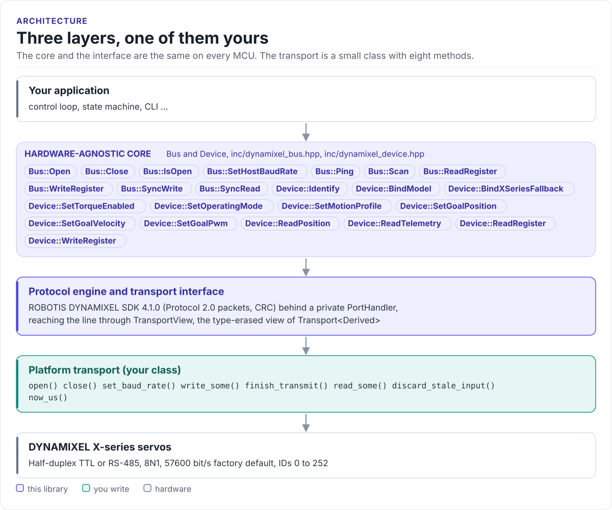
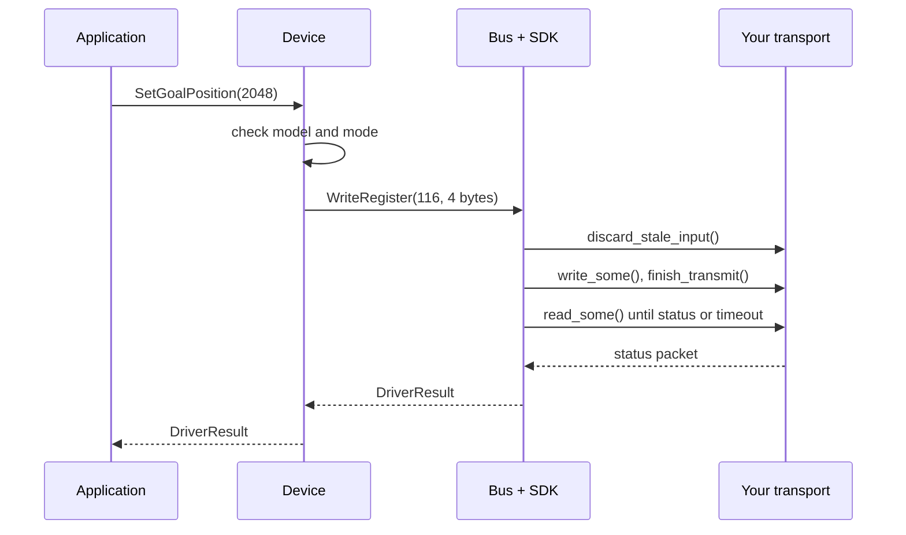

# Architecture

How the driver is put together: three layers, what each owns, and how one call reaches a servo.

<!-- figure: driver-layers -->
<picture>
  <source media="(prefers-color-scheme: dark)" srcset="diagrams/driver-layers.dark.svg">
  
</picture>
<!-- /figure -->

## The three layers

| Layer | Where | You change it |
| --- | --- | --- |
| **Core**: `Bus`, `Device`, model catalog | [`inc/`](../inc/dynamixel.hpp), [`src/`](../src/dynamixel_bus.cpp) | Never, for a new board |
| **Protocol engine and interface**: the SDK, `TransportView` | [`src/backend/`](../src/backend/port_handler_adapter.hpp), [`inc/dynamixel_transport.hpp`](../inc/dynamixel_transport.hpp) | Never |
| **Platform transport**: your class | Your project | Once per MCU ([Porting](porting.md)) |

Everything above the transport is the same on ESP32, STM32, a Linux host or the test fake. That is how the
[host tests](testing.md) run the real SDK without a servo.

## How one call reaches a servo

The SDK's packet handler builds the packet and checks the reply; the private `PortHandler` adapter translates its
`clearPort()`, `writePort()` and `readPort()` calls into the transport calls above.

## Design choices

- **The SDK does the protocol.** The driver does not reimplement Protocol 2.0: it compiles four SDK source files
  (packet handler, group handler, sync read, sync write) and gives the SDK a private `PortHandler` that talks to
  your transport. Public headers never include the SDK. [SDK integration](sdk-integration.md) has the details.
- **CRTP transport, type-erased bus.** Your transport derives from `Transport<Derived>`, so hook calls are
  resolved at compile time. `Bus` takes a `TransportView` (a pointer and a table of function pointers) instead
  of a template parameter, so `Bus` and `Device` are ordinary classes compiled once in `src/`.
- **Ownership.** The transport outlives the bus; the bus outlives its devices. `Bus` is movable, not copyable.
- **Nothing happens in a constructor.** Constructing a `Bus` or a `Device` sends nothing. `Identify()` only
  reads. Torque, mode, ID and baud changes are always explicit calls.
- **One owner per bus.** `Bus` is not thread-safe: the SDK's `is_using_` flag is not a lock. Give each bus one
  task, or guard every call with one mutex (hf-core's `DynamixelHandler` takes an `RtosMutex`).

## Source map

| Path | Contents |
| --- | --- |
| `inc/dynamixel.hpp` | Umbrella header, version functions |
| `inc/dynamixel_bus.hpp`, `src/dynamixel_bus.cpp` | `Bus`: open, ping, scan, register access, sync read and write |
| `inc/dynamixel_device.hpp`, `src/dynamixel_device.cpp` | `Device`: identify, torque, mode, goals, telemetry |
| `inc/dynamixel_model.hpp` | `ModelDescriptor`, the X-series register map, the catalog, `Telemetry` |
| `inc/dynamixel_transport.hpp` | `Transport<Derived>`, `TransportView`, `TransportConfig` |
| `inc/dynamixel_types.hpp` | `DriverError`, `DriverResult`, `CommDetail`, policies, `OperatingMode` |
| `src/backend/port_handler_adapter.hpp` | The private SDK `PortHandler` over `TransportView` |
| `src/dynamixel_status.cpp` | `MapCommCode()`: SDK `COMM_*` codes to `DriverError` |
| `external/DynamixelSDK` | ROBOTIS DYNAMIXEL SDK 4.1.0 (submodule) |
| `tests/host/`, `tests/docs/` | Host tests and the compiled documentation snippets |
| `examples/esp32/`, `examples/host/` | ESP-IDF applications, host ping example |
