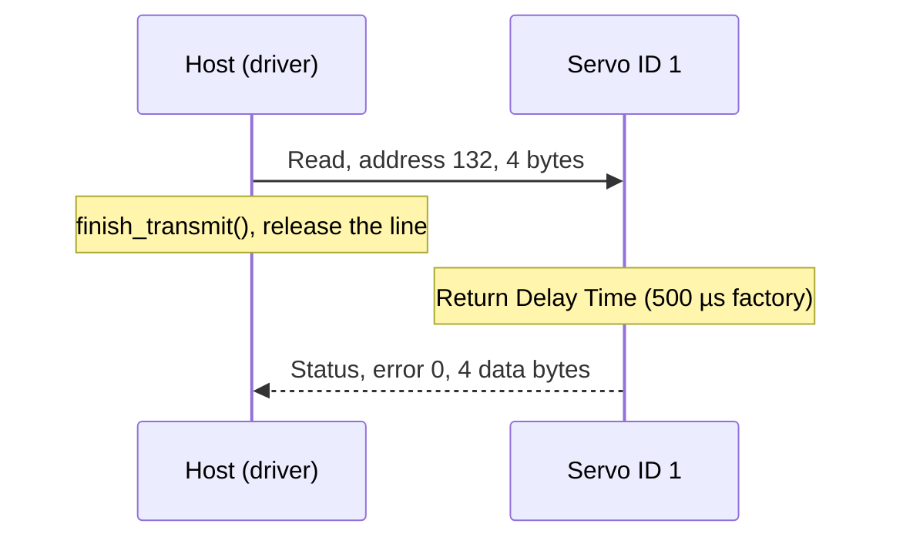

# Hardware

What to connect between your MCU and DYNAMIXEL X-series servos, with which bus settings, and the traps of a
half-duplex line.

All values here come from the ROBOTIS e-Manual pages for the
[XC430-W150](https://emanual.robotis.com/docs/en/dxl/x/xc430-w150/), the
[XM430-W350](https://emanual.robotis.com/docs/en/dxl/x/xm430-w350/) and
[Protocol 2.0](https://emanual.robotis.com/docs/en/dxl/protocol2/). Other X-series models differ in supply range
and in some control-table units: check the e-Manual page of your model.

## Connectors

The bus is multidrop: every servo shares GND, VDD and DATA, and each answers only to its own ID.

| Pin | TTL (3-pin) | RS-485 (4-pin) |
| --- | --- | --- |
| 1 | GND | GND |
| 2 | VDD (servo supply) | VDD (servo supply) |
| 3 | DATA | DATA+ |
| 4 | | DATA- |

Housings are JST EHR-03 (TTL) and EHR-04 (RS-485), with SEH-001T-P0.6 crimp terminals. The XC430-W150 is TTL
only; the XM430-W350 comes in a TTL and an RS-485 version.

## Half-duplex wiring

TTL DATA is one wire that carries both directions, so the MCU's TX and RX must take turns. The transport you
write handles the turn-around; the driver never touches a pin. Three wirings work:

| Wiring | Turn-around in the transport | `EchoPolicy` |
| --- | --- | --- |
| Buffer or RS-485 transceiver with a DIR pin | DIR on to send, off in `finish_transmit()` | `None` |
| Auto-direction transceiver | None | `None` |
| TX and RX joined, open drain | None; RX hears TX and the driver drops it | `ExpectedLocalEcho` |

ROBOTIS's reference TTL circuit is designed for a 5 V or 5 V tolerant MCU and says to use a level shifter
otherwise. On a 3.3 V MCU such as the ESP32, put a buffer or level shifter rated for both levels between the UART
and DATA. A transistor TTL adapter is fine for bench reads at 57600 bit/s; qualify a proper buffer before high
baud rates or long cables.

RS-485 needs a transceiver with DATA+ and DATA- to pins 3 and 4, and a direction pin unless it switches
automatically.

## Bus settings

| Setting | Value |
| --- | --- |
| Format | 8 data bits, no parity, 1 stop bit, asynchronous |
| Speed | 9600, 57600, 115200 bit/s, 1, 2, 3, 4 or 4.5 Mbit/s (Baud Rate, address 8, index 0 to 7) |
| Factory setting | 57600 bit/s (index 1), ID 1 |
| IDs | 0 to 252; 254 (`0xFE`) is broadcast |
| Reply delay | Return Delay Time (address 9), 2 µs per unit; factory value 250 (500 µs) |

The host and every servo on the bus must use the same rate. Change a servo's rate with a register write, then
follow it with `Bus::SetHostBaudRate()` ([API guide](api-guide.md#change-the-baud-rate)).

## Protocol 2.0

The host sends an instruction packet and, unless it was broadcast, the addressed servo answers with a status
packet. Every multi-byte field is little-endian.

| Field | Instruction packet | Status packet |
| --- | --- | --- |
| Header, reserved | `FF FF FD 00` | `FF FF FD 00` |
| ID | Target servo, or `FE` | Answering servo |
| Length (2 bytes) | Parameters + 3 | Parameters + 4 |
| Instruction | Ping `01`, Read `02`, Write `03`, Sync Read `82`, Sync Write `83` | `55` |
| Error | | Bit 7: hardware alert; bits 0 to 6: error number |
| Parameters, CRC-16 | Address and data | Data |



The same exchange on the wire, reading Present Position:

```text
host  -> FF FF FD 00  01  07 00  02  84 00 04 00        CRC_L CRC_H
servo -> FF FF FD 00  01  08 00  55  00  p0 p1 p2 p3   CRC_L CRC_H
         header       ID  length  inst err/params
```

The SDK builds and checks these packets; the driver turns a missing or corrupt status into `Timeout` or
`ChecksumError` and the error byte into `DeviceError`.

## Power

| Model | Supply (V) | Recommended (V) |
| --- | --- | --- |
| XC430-W150 | 6.5 to 14.8 | 12.0 |
| XM430-W350 | 10.0 to 14.8 | 12.0 |

The servos do not run from 3.3 V or 5 V. Feed pin 2 from a supply sized for the stall current of every servo on
the bus (1.4 A for one XC430-W150 at 12 V), join its ground to the MCU's and keep the logic path between them
level-compatible. Present Input Voltage (address 144, 0.1 V per unit) reads the supply at each servo.

## Control table used by the driver

The driver's X-series descriptor ([`inc/dynamixel_model.hpp`](../inc/dynamixel_model.hpp)) uses these addresses.
EEPROM entries can only be written while torque is off.

| Address | Name | Bytes, area |
| --- | --- | --- |
| 0 | Model Number | 2, EEPROM |
| 6, 7, 8 | Firmware Version, ID, Baud Rate | 1 each, EEPROM |
| 11 | Operating Mode | 1, EEPROM |
| 64 | Torque Enable | 1, RAM |
| 70 | Hardware Error Status | 1, RAM |
| 100, 102, 104 | Goal PWM, Goal Current, Goal Velocity | 2, 2, 4, RAM |
| 108, 112 | Profile Acceleration, Profile Velocity | 4 each, RAM |
| 116 | Goal Position | 4, RAM |
| 124, 126 | Present PWM, Present Load or Current | 2 each, RAM |
| 128, 132 | Present Velocity, Present Position | 4 each, RAM |
| 144, 146 | Present Input Voltage, Present Temperature | 2, 1, RAM |

Units on the XC430-W150: position 1 pulse (4096 per revolution, 0.088°), velocity 0.229 rev/min, PWM 0.113 %,
load 0.1 %. On XM and XH models address 126 is Present Current, 2.69 mA per unit on the XM430-W350.

## Example boards

The [ESP32 examples](examples.md) run on an ESP32-C6 or ESP32-S3 with UART1:

| MCU | TX | RX |
| --- | --- | --- |
| ESP32-C6 | GPIO4 | GPIO5 |
| ESP32-S3 | GPIO17 | GPIO18 |

The pins, an optional direction GPIO and the baud rate are Kconfig options
([`Kconfig.projbuild`](../examples/esp32/main/Kconfig.projbuild)).

## Reference documents

| Document | What it is for |
| --- | --- |
| [XC430-W150 e-Manual](https://emanual.robotis.com/docs/en/dxl/x/xc430-w150/) | The first validated servo: specifications, control table, connector |
| [XM430-W350 e-Manual](https://emanual.robotis.com/docs/en/dxl/x/xm430-w350/) | A current-capable model, TTL and RS-485 |
| [Protocol 2.0](https://emanual.robotis.com/docs/en/dxl/protocol2/) | Packet format, instructions, error byte |
| [DYNAMIXEL SDK](https://github.com/ROBOTIS-GIT/DynamixelSDK) | The protocol engine the driver wraps |
