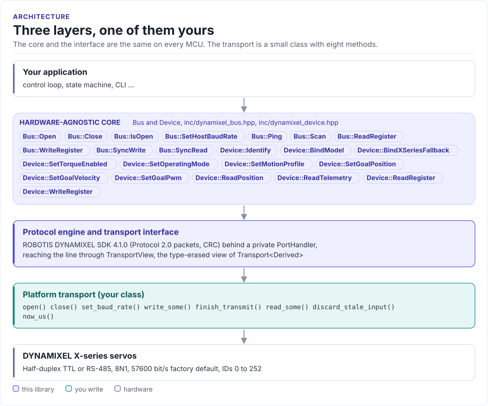

# Porting

Run the driver on a new MCU by writing one class: a UART transport derived from `dynamixel::Transport<Self>`.

The driver never calls your SDK directly. It calls eight methods on your class, declared in
[`inc/dynamixel_transport.hpp`](../inc/dynamixel_transport.hpp). The base class uses CRTP, so the calls are
resolved at compile time; the bus holds the class through a `TransportView`, a pointer and a table of function
pointers, so `Bus` itself is not a template.

<!-- figure: driver-layers -->
<picture>
  <source media="(prefers-color-scheme: dark)" srcset="diagrams/driver-layers.dark.svg">
  
</picture>
<!-- /figure -->

## What you implement

| Method | Contract |
| --- | --- |
| `open(cfg)` | Configure the UART for `cfg.baud_rate`, 8N1. Send nothing. Return `DriverError::None` or `SerialError` |
| `close()` | Release the UART |
| `set_baud_rate(baud)` | Change the host rate only |
| `write_some(data, n)` | Queue up to `n` bytes; return how many were accepted. A partial write is fine: the driver calls again |
| `finish_transmit()` | Block until the last stop bit is on the wire, then release the line for the reply |
| `read_some(out, max)` | Copy the bytes that have arrived, up to `max`, without blocking. 0 bytes is not an error |
| `discard_stale_input()` | Drop everything in the receive buffer; called at the start of a transaction |
| `now_us()` | A monotonic microsecond clock; reply timeouts are measured with it |
| `delay_ms_impl(ms)`, `yield_impl()` | Optional. Without them the base versions do nothing |

Return `DriverError::SerialError` (or `{0, SerialError}`) only for a UART failure. Timeouts, checksums and echo
checks are the driver's job.

## The transport

```cpp title="my_uart.hpp"
--8<-- "tests/docs/my_uart.hpp:port"
```

Then bind it, with braces:

```cpp
MyUart uart;
dynamixel::Bus bus{dynamixel::TransportView{uart}};
```

## Rules for the half-duplex line

- **Turn around in `finish_transmit()`.** It must not return before the UART's shift register is empty: release
  the direction pin earlier and the last byte is cut; later and the start of the reply is lost. The factory
  Return Delay Time gives you 500 µs.
- **Flip DIR in the transport, nowhere else.** `Device` and `Bus` never see a pin. With an auto-direction
  transceiver there is nothing to flip.
- **Single wire, TX and RX joined:** leave RX enabled while you transmit and set
  `EchoPolicy::ExpectedLocalEcho`. The driver reads back and checks the echo itself; `read_some()` returns the
  echo bytes like any others.
- **No delays of your own.** The reply timeout already allows for the packet time and `latency_ms`.
- **Give `read_some()` a receive buffer.** It is polled; bytes that arrive between polls must not be dropped.
  A ring buffer filled by an interrupt or the UART driver's own FIFO is enough.

## Reference implementations

| Transport | Where |
| --- | --- |
| ESP-IDF UART, optional direction GPIO | [`hf_dynamixel_esp_uart.hpp`](../examples/esp32/main/include/hf_dynamixel_esp_uart.hpp) |
| hf-core `BaseUart` | `HalUartDynamixelComm` in hf-core, `handlers/dynamixel/DynamixelHandler.h` |
| Scripted fake for host tests | [`tests/host/fake_transport.hpp`](../tests/host/fake_transport.hpp) |

The ESP-IDF transport is a template over the UART number, the TX, RX and DIR pins and the DIR polarity; it uses
`uart_wait_tx_done()` for `finish_transmit()` and `esp_timer_get_time()` for `now_us()`.

## Check your transport

1. Build it: the transport on this page is compiled by the host CI from
   [`tests/docs/my_uart.hpp`](../tests/docs/my_uart.hpp), with `Transport<MyUart>` instantiated over it.
2. `Bus::Ping(1)` on a factory servo at 57600 bit/s: a `PingInfo` with model 1070 for an XC430-W150 proves both
   directions.
3. Read Present Position in a loop of 1000 reads: any `Timeout` or `ChecksumError` points at the turn-around or
   the receive path.
4. On a single-wire link, `EchoMismatch` means `echo_policy` does not match the wiring.

## Threads

The driver is not thread-safe. Give each bus one owner task, or guard every call on a bus, its devices and its
transport with one mutex. Separate buses on separate UARTs can run in parallel.
